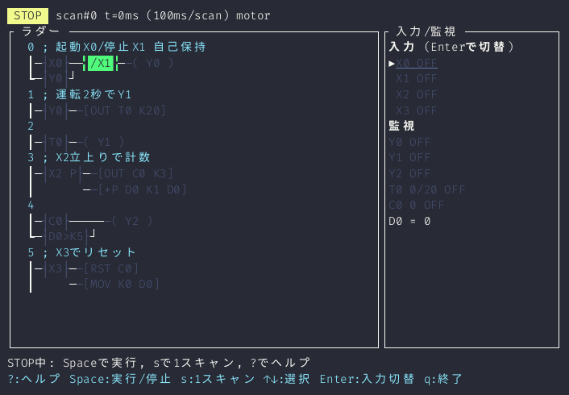

# plcemu

MELSEC iQ-R 系ラダー(命令リスト)を端末で動かすRust製シミュレータ。TUI・ヘッドレスCLI・テストランナー・stdio MCPサーバ。



(GIFは `scripts/record-demo.sh` で実際のTUIをtmux経由でキー操作して asciinema+agg で撮影: X0投入→自己保持→RUNでタイマT0によりY1 ON→X2で計数→ヘルプ表示)

## 起動
Rust (rustup) が必要。新しい環境では `sh scripts/cargo.sh build` が rustup の既定ツールチェーン未設定時に stable(minimal) を入れてからビルドする。
```sh
cargo build --release
./target/release/plcemu tui examples/motor.plc.json --scan-ms 100   # ? でヘルプ
./target/release/plcemu run examples/motor.plc.json --scan-ms 100 --scans 21 --set X0=1@0 [--trace]
./target/release/plcemu test examples/motor.test.json      # 失敗時 exit 1 + JSON
./target/release/plcemu check examples/motor.plc.json
./target/release/plcemu import melsec-il examples/motor.il.txt  # keyence-kv は入口のみ(未実装)
./target/release/plcemu mcp                                 # stdio MCP (tools: simulate, run_tests, check_program)
```
TUI操作: `Space` 実行/停止, `s` 1スキャン, `↑↓` 入力選択, `Enter` 入力ON/OFF, `r` リセット, `PgUp/PgDn` スクロール, `?` ヘルプ, `q` 終了。ON/導通 = 反転+太字(色が使える端末では緑)、接点は `┫X0┣`・コイルは `(( Y0 ))` の太線表示。OFF = 灰/薄字で `┤X0├`・`( Y0 )`。`NO_COLOR` 設定時は色を使わず反転と線種で示す。

MCP設定例: `{"mcpServers":{"plcemu":{"command":"/path/to/plcemu","args":["mcp"]}}}`

## プログラム形式 `plcemu-ladder` v1
```json
{"format":"plcemu-ladder","version":1,"name":"motor","timer_unit_ms":100,
 "rungs":[{"comment":"自己保持","il":["LD X0","OR Y0","ANI X1","OUT Y0"]}]}
```
形式(`src/format.rs`)と実行モデル(`src/engine.rs`)は分離。未知の format/version は拒否。ベンダ形式は `Importer` トレイト経由(`melsec-il`: 命令リストテキスト, `keyence-kv`: 未実装の入口)。

## テスト形式 `plcemu-test` v1
`examples/motor.test.json` 参照。各stepで `set`(デバイス書込) → `scans` または `ms`(切上げでスキャン数) → `expect`(TS/TN/CS/CN/D/Y/M…)。失敗例: `examples/failing.test.json`。

## 対応命令
LD LDI AND ANI OR ORI LDP LDF ANDP ANDF ORP ORF ANB ORB MPS MRD MPP OUT SET RST, OUT T K, OUT C K, MOV(P), +/-/*// (ADD/SUB/MUL/DIV, P付), LD/AND/OR + = <> > < >= <=。
デバイス: X,Y(16進) M T C D, 定数 K/H。詳細・三菱電機資料との相違と制約は [docs/melsec-compat.md](docs/melsec-compat.md)。
制約: 16bitのみ、FB・実機接続・GX Worksネイティブ形式非対応、TUIのラダー表示は命令列から作る簡易図(OR分岐を下段に表示)。

## CI
`.github/workflows/ci.yml`: fmt, clippy(-D warnings), cargo test, CLIスモーク, MCPスモーク(`scripts/mcp-smoke.sh`)。
